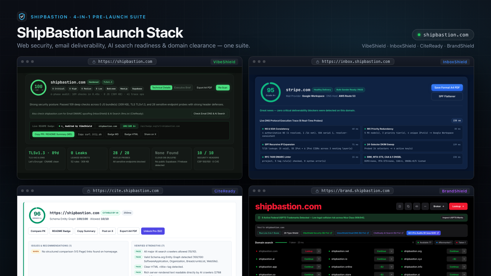

# OmniForge · Pre-Launch Engineering & Security Tools (`zColdWater`)


<!-- shipbastion-hero:start -->
<p align="center">
  <a href="https://shipbastion.com/">
    
  </a>
</p>

*Live production suite at [shipbastion.com](https://shipbastion.com/) · [inbox.shipbastion.com](https://inbox.shipbastion.com/) · [cite.shipbastion.com](https://cite.shipbastion.com/) · [brand.shipbastion.com](https://brand.shipbastion.com/).*
<!-- shipbastion-hero:end -->

Free, zero-signup web diagnostics, open-source MIT checklists, CLIs, and MCP servers for indie builders shipping with **Cursor, Lovable, Bolt, v0, Next.js, Vercel, Cloudflare, and Supabase**.

[](https://zcoldwater.github.io/launch-audit-reports/tools/)
[](https://shipbastion.com)
[](https://inbox.shipbastion.com)
[](https://brand.shipbastion.com)
[](https://cite.shipbastion.com)
[](https://github.com/twf-nikhila/Awesome-Black-Friday-Cyber-Monday-deals)

---

## Live Free Web Scanners (Zero Signup, Instant Browser Audit)

| Tool | What It Audits Live | Free Tier | Launch Special Unlock |
| --- | --- | --- | --- |
| **[VibeShield v7.0](https://shipbastion.com)** | 6-phase passive security scan (`116` checks): client JS bundles (52 secret patterns), 10 Mozilla Observatory headers, CSP AST, 28 SPA-filtered paths & safe Supabase/Firebase probes | Full 6-phase score, severity breakdown & live trace | **$2** one-time (was ~~$9~~) — exact line locations + 5-platform fixes ([Unlock](https://api.shipbastion.com/go/gumroad/vibeshield)) |
| **[InboxShield v7.0](https://inbox.shipbastion.com)** | 6-phase email DNS & deliverability audit: recursive SPF `<=10` lookup flattener, 24 DKIM selectors, DMARC syntax, MTA-STS, BIMI & 5 DNSBLs | Full DNS score, protocol trace & [SPF Flattener](https://inbox.shipbastion.com/spf-flattener) | **$2** one-time (was ~~$9~~) — zero-conflict registrar fix records ([Unlock](https://api.shipbastion.com/go/gumroad/inboxshield)) |
| **[CiteReady v6.0](https://cite.shipbastion.com)** | AI Search & GEO readiness: 10 global & China AI crawlers, Schema.org `@graph` Builder, `/robots-builder`, competitor PK & `/llms.txt` compiler | Full AI readiness audit, [`/llms.txt` Generator](https://cite.shipbastion.com/generator), [`/robots-builder`](https://cite.shipbastion.com/robots-builder) & [`/schema-builder`](https://cite.shipbastion.com/schema-builder) | **$2** one-time (was ~~$12~~) — 5-platform Schema & `/llms.txt` fixes ([Unlock](https://api.shipbastion.com/go/gumroad/citeready)) |
| **[BrandShield v6.5](https://brand.shipbastion.com)** | Startup domain & trademark clearance: 78+ TLD direct IANA RDAP (`/tlds`), **28-variant Typosquatting Shield (`/typos`)**, live USPTO Class 009/042 check & [AI Brand Namer](https://brand.shipbastion.com/namer) | **100% Free** (all features unlocked, no paywall) | Free forever |

> **OmniForge Complete Suite (All 3 Pro Unlocks):** **$5** one-time Launch Special (was ~~$29~~, zero monthly subscription, 14-day refund guarantee) — [Gumroad](https://api.shipbastion.com/go/gumroad/launch-stack) · [Direct Checkout](https://api.shipbastion.com/checkout/launch-stack)

### Zero-Install Terminal Audits (`curl | sh`, POSIX `sh` — Zero Dependencies)

```bash
# Run any single flagship auditor directly from your terminal (CI gate: --fail-below 80)
curl -fsSL https://shipbastion.com/cli.sh      | sh -s -- yourdomain.com
curl -fsSL https://inbox.shipbastion.com/cli.sh     | sh -s -- yourdomain.com
curl -fsSL https://cite.shipbastion.com/cli.sh | sh -s -- yourdomain.com
curl -fsSL https://brand.shipbastion.com/cli.sh     | sh -s -- YourBrand

# Or run Security + Email DNS + AI Search concurrently in one command:
curl -fsSL https://api.shipbastion.com/cli.sh    | sh -s -- --suite yourdomain.com
```

---

## Featured 2026 Research & Open-Source Repositories (MIT)

- **[14 Free Live Pre-Launch Diagnostic Tools](https://zcoldwater.github.io/launch-audit-reports/tools/)** — Includes the live 3-engine `/v1/quick-score` suite auditor + live SVG README badge builder & 14 focused checkers: [SPF 10-Lookup](https://zcoldwater.github.io/launch-audit-reports/tools/spf-permerror-checker.html) · [DMARC `p=reject`](https://zcoldwater.github.io/launch-audit-reports/tools/dmarc-reject-checker.html) · [BIMI & MTA-STS](https://zcoldwater.github.io/launch-audit-reports/tools/bimi-mta-sts-checker.html) · [Resend/Postmark DNS](https://zcoldwater.github.io/launch-audit-reports/tools/resend-dns-checker.html) · [Google Workspace/M365 DMARC](https://zcoldwater.github.io/launch-audit-reports/tools/google-workspace-dmarc-checker.html) · [`/llms.txt` Validator](https://zcoldwater.github.io/launch-audit-reports/tools/llms-txt-validator.html) · [Schema.org Entity Graph Validator](https://zcoldwater.github.io/launch-audit-reports/tools/schema-jsonld-validator.html) · [AI Crawler Checker](https://zcoldwater.github.io/launch-audit-reports/tools/ai-crawler-robots-checker.html) · [52-Rule JS Secret Scanner](https://zcoldwater.github.io/launch-audit-reports/tools/js-secret-leak-scanner.html) · [CSP Nonce Checker](https://zcoldwater.github.io/launch-audit-reports/tools/csp-header-generator.html) · [CORS Checker](https://zcoldwater.github.io/launch-audit-reports/tools/cors-misconfig-checker.html) · [Next.js Headers Checker](https://zcoldwater.github.io/launch-audit-reports/tools/nextjs-security-headers-checker.html) · [28-Variant Typosquatting Checker](https://zcoldwater.github.io/launch-audit-reports/tools/typosquatting-domain-checker.html) · [78-TLD & USPTO Checker](https://zcoldwater.github.io/launch-audit-reports/tools/uspto-domain-checker.html).
- **Interactive Security, DNS, GEO & Domain Generators (Zero Signup):** [Supabase RLS Policy SQL Generator](https://zcoldwater.github.io/vibeshield-cli/supabase-rls-policy-generator.html) · [Next.js Nonce CSP Builder](https://zcoldwater.github.io/vibeshield-cli/nextjs-nonce-csp-builder.html) · [Live Launch Score SVG Badge Studio](https://zcoldwater.github.io/omniforge-skills/launch-score-badge-generator.html) · [AI Crawler WAF Allowlist Generator](https://zcoldwater.github.io/citeready-cli/ai-crawler-user-agents-2026.html) · [`/llms.txt` Spec Linter](https://zcoldwater.github.io/citeready-cli/llms-txt-validator-2026.html) · [5-Year TLD Renewal Calculator](https://zcoldwater.github.io/brandshield-cli/domain-renewal-5yr-calculator.html) · [Domain Hack Generator](https://zcoldwater.github.io/brandshield-cli/domain-hack-generator.html) · [Black Friday 2026 Launch Deal](https://zcoldwater.github.io/omniforge-skills/black-friday-2026-developer-security-deal.html).
- **[State of AI & Vibe-Coded Web App Security (2026)](https://zcoldwater.github.io/launch-audit-reports/vibe-security-2026/)** — Empirical passive audit of 55 freshly launched AI-built web apps (`6,120+` checks; archived in [`awesome-annual-security-reports`](https://github.com/jacobdjwilson/awesome-annual-security-reports)): `74.5%` miss 8–9 of 10 security headers, `20.0%` run live Supabase backends, and `3.6%` leaked client secrets (strictly anonymized). 8 Stack Guides: [Lovable](https://zcoldwater.github.io/launch-audit-reports/vibe-security-2026/lovable.html) · [Cursor & Next.js](https://zcoldwater.github.io/launch-audit-reports/vibe-security-2026/cursor.html) · [v0.dev & Vercel](https://zcoldwater.github.io/launch-audit-reports/vibe-security-2026/v0.html) · [Bolt & Netlify](https://zcoldwater.github.io/launch-audit-reports/vibe-security-2026/bolt.html) · [Replit Agent](https://zcoldwater.github.io/launch-audit-reports/vibe-security-2026/replit.html) · [Supabase RLS](https://zcoldwater.github.io/launch-audit-reports/vibe-security-2026/supabase.html) · [Firebase Rules](https://zcoldwater.github.io/launch-audit-reports/vibe-security-2026/firebase.html) · [Cloudflare Pages/Workers](https://zcoldwater.github.io/launch-audit-reports/vibe-security-2026/cloudflare.html).
- **2026 Empirical SaaS & AI Startup Benchmarks (All Live Measured):** [State of AI Startup Infrastructure 2026 Portal](https://zcoldwater.github.io/omniforge-skills/state-of-ai-startup-infrastructure-2026.html) · [228 SaaS Email Deliverability Study](https://zcoldwater.github.io/launch-audit-reports/email-deliverability-2026/) · [Top 60 AI/SaaS Email Auth Benchmark](https://zcoldwater.github.io/inboxshield-cli/top-60-saas-email-authentication-benchmark-2026.html) · [228 SaaS `/llms.txt` Study](https://zcoldwater.github.io/launch-audit-reports/ai-search-2026/) · [Top 50 AI/Dev GEO Leaderboard](https://zcoldwater.github.io/citeready-cli/ai-search-readiness-benchmark-2026.html) · [Top 60 SaaS Security Headers Benchmark](https://zcoldwater.github.io/vibeshield-cli/web-security-headers-benchmark-2026.html) · [Top 60 Dev/AI `security.txt` & Isolation Benchmark](https://zcoldwater.github.io/vibeshield-action/security-txt-sourcemap-benchmark-2026.html) · [Top 100 AI Startups `.ai` vs `.com` TLD Benchmark](https://zcoldwater.github.io/brandshield-cli/ai-startup-tld-benchmark-2026.html).
- **[`vibe-security-checklist` (`v1.2.0`)](https://github.com/zColdWater/vibe-security-checklist)** ([Live Interactive Workbench](https://zcoldwater.github.io/vibe-security-checklist/)) — Copy-paste MIT `vercel.json`, Next.js `next-headers.mjs`, Netlify `_headers`, Cloudflare Workers, Nginx, Supabase RLS SQL, Firestore rules, `.cursor/rules/security.mdc`, zero-install `curl /cli.sh` & local bundle secret guard.
- **[`launch-audit-reports`](https://zcoldwater.github.io/launch-audit-reports/)** — Live measured SPF/DMARC & AI-search benchmarks across `228` SaaS & developer-tool domains, `10` troubleshooting guides, and [4 honest competitor comparisons](https://zcoldwater.github.io/launch-audit-reports/compare/).
- **[`mcp-launch-audit`](https://github.com/zColdWater/mcp-launch-audit)** — Official MCP server exposing 5 read-only pre-launch audit tools (`audit_web_app_security`, `audit_email_deliverability`, `audit_ai_search_readiness`, `check_brand_clearance`, `flatten_spf_record`) for Claude Desktop, Cursor, and Windsurf.
- **GitHub Actions & Agent Skills (`skills.sh`):** [`vibeshield-action`](https://github.com/zColdWater/vibeshield-action) · [`inboxshield-action`](https://github.com/zColdWater/inboxshield-action) · [`citeready-action`](https://github.com/zColdWater/citeready-action) · [`omniforge-skills`](https://github.com/zColdWater/omniforge-skills) ([Vercel `skills.sh`](https://www.skills.sh/zColdWater/omniforge-skills))
- **Open-Source CLIs:** [`vibeshield-cli`](https://github.com/zColdWater/vibeshield-cli) · [`inboxshield-cli`](https://github.com/zColdWater/inboxshield-cli) · [`citeready-cli`](https://github.com/zColdWater/citeready-cli) · [`brandshield-cli`](https://github.com/zColdWater/brandshield-cli)

---

**Contact & Support:** OmniForge · Agent Arena Studio · `agentarenastudio@proton.me` · [@agentarenastudi](https://x.com/agentarenastudi) · [Support Portal](https://api.shipbastion.com/support) · [14-Day Refund Policy](https://api.shipbastion.com/refund-policy)
